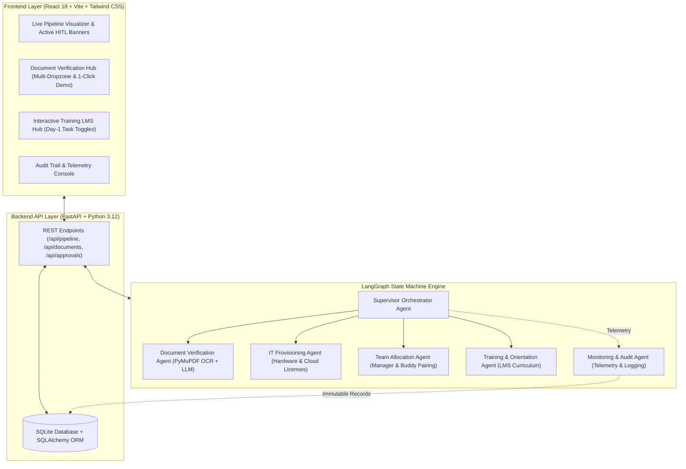
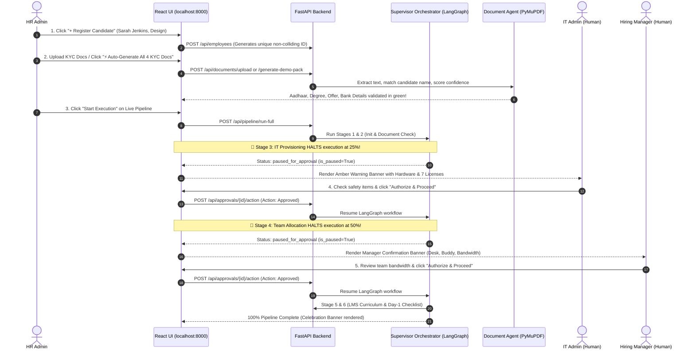

# 🚀 EnterpriseFlow AI: Project Guide & 4-Person Presentation Blueprint

**Project Name:** EnterpriseFlow AI — Autonomous Multi-Agent Onboarding Platform with Active Human-in-the-Loop (HITL) Governance  
**Repository:** `enterpriseflow-ai`  
**Web Application URL:** `http://localhost:8000`  
**Target Audience:** Hackathon Judges, University Faculty, and Team Members  

---

# PART 1: COMPLETE TEAM REFERENCE & PROJECT FLOW

## 1. Executive Summary & Problem Statement
In modern enterprises, onboarding a new employee is slow, disorganized, and risky:
* **The Problem:** It takes an average of **7 to 14 days** across HR, IT, and Department Managers to onboard a single employee. HR manually inspects documents, IT is flooded with Jira tickets for laptops and software licenses, and managers scramble to assign desks and mentors on Day 1.
* **The Danger of Pure Automation:** If an autonomous AI script blindly assigns hardware and privileged cloud access without supervision, it creates critical security risks and compliance violations.
* **The EnterpriseFlow AI Solution:** An intelligent **6-Agent Autonomous Workforce** orchestrated via **LangGraph**. It reduces onboarding from **weeks to under 3 minutes** while introducing **Active Human-in-the-Loop (HITL) Checkpoints** where execution physically pauses on screen until authorized human personnel review and approve high-impact actions.

---

## 2. Key Business Value & Impact

| Metric / Aspect | Traditional Onboarding | EnterpriseFlow AI Platform |
| :--- | :--- | :--- |
| **Cycle Time** | 7 – 14 business days | **< 3 minutes** (Automated & Governed) |
| **Document Verification** | Manual physical inspection; error-prone | **Sub-second OCR & LLM extraction** with confidence scoring |
| **IT & Security Risk** | Over-privileged cloud accounts; lost tickets | **Role-based auto-tiering with mandatory human authorization** |
| **Day-1 Readiness** | Missing software access, no assigned buddy | **Automated personalized LMS, buddy pairing, and desk reservation** |
| **Auditability** | Disconnected emails and ticket logs | **100% Cryptographic, immutable event trail in SQLite** |

---

## 3. System Architecture & Tech Stack

---

## 4. The 6-Agent Workforce

1. **Supervisor Orchestrator Agent (`orchestrator.py`):** The brain of the system built on LangGraph. Evaluates global onboarding state, tracks milestone percentages, enforces active freezing at compliance gates, and coordinates worker agents.
2. **Document Verification Agent (`document_verification.py` + `ocr_service.py`):** Ingests uploaded PDFs/images, parses text using PyMuPDF, validates candidate name matching against registration data, and calculates confidence scores.
3. **IT Provisioning Agent (`it_provisioning.py`):** Computes department-specific hardware allocations (e.g., MacBook Pro M3 vs. ThinkPad) and generates SaaS license bundles (Slack, GitHub, Figma, AWS).
4. **Team Allocation Agent (`team_allocation.py`):** Assigns the employee to an internal squad, pairs them with an experienced peer buddy, reserves a physical desk, and alerts the reporting manager.
5. **Training & Orientation Agent (`training_orientation.py`):** Automatically curates a customized 4-module Day-1 LMS curriculum and populates an interactive onboarding checklist.
6. **Monitoring & Audit Agent (`monitoring_audit.py`):** Observes every agent operation and human authorization, generating immutable cryptographic event records stored in SQLite.

---

## 5. End-to-End Step-by-Step Technical Flow

---

# PART 2: 4-SPEAKER PRESENTATION SCRIPT FOR HACKATHON & FACULTY

**Total Target Time:** 8 to 10 Minutes (2 to 2.5 minutes per speaker) + 2 minutes Q&A  
**Live Demo Screen:** Laptop displaying `http://localhost:8000` connected to the projector.

---

### 🎤 Speaker 1: The Visionary & Problem Pitch Lead
**Role:** Introduces the team, defines the core problem, presents the business value, and gives a high-level architectural overview.

* **Spoken Dialogue:**
  > *"Respected faculty and judges, good morning. Imagine this scenario: A top-tier engineer accepts an offer at a Fortune 500 company. On Day 1, they sit idle for three days because their laptop hasn't been approved, their GitHub permissions are stuck in an IT queue, and HR is still manually cross-checking their university diploma.*
  >
  > *In corporate enterprises, employee onboarding takes an average of **10 to 14 days** and requires coordination across three disconnected departments: HR, IT, and Team Managers. This results in lost productivity, massive ticket backlogs, and severe security risks from unvetted access.*
  >
  > *Today, our team presents **EnterpriseFlow AI** — an autonomous multi-agent enterprise onboarding platform. Powered by **LangGraph**, **PyMuPDF**, and **FastAPI**, our system reduces onboarding time from **weeks to under three minutes**.*
  >
  > *Crucially, we do not believe in unchecked, blind AI automation. We have engineered **Active Human-in-the-Loop Governance** where high-impact actions—like provisioning enterprise credentials or allocating department resources—are actively frozen on screen until authorized human supervisors give their sign-off.*
  >
  > *Let me now hand over to [Speaker 2], who will walk you through candidate ingestion and our automated document intelligence hub."*

---

### 🎤 Speaker 2: The AI & Document Intelligence Lead
**Role:** Demonstrates candidate registration and explains the Document Verification Hub (OCR, PyMuPDF, batch uploads, candidate-specific synthetic PDF generation, and confidence scoring).

* **Spoken Dialogue (While interacting with the live screen):**
  > *"Thank you, [Speaker 1]. Let's look at the live platform at `localhost:8000`.*
  >
  > *(Clicking `+ Register Candidate`)*  
  > *First, we register our new candidate: **Sarah Jenkins**, joining as a **Staff UX Designer** in the **Design** department. The moment we register Sarah, our backend provisions a non-colliding enterprise ID—`EMP-2024-XXXXXX`—and generates her corporate identity.*
  >
  > *(Switching to the `Document Verification` tab)*  
  > *Next is candidate KYC verification. In standard systems, HR must review 4 mandatory documents: Government ID (Aadhaar), Degree Certificate, Signed Offer Letter, and Bank Details.*
  >
  > *In our platform, we support both a **Multi-File Batch Dropzone** where candidates can drag and drop all four documents simultaneously, and a **1-Click Auto-Generate Demo Pack** button powered by PyMuPDF.*
  >
  > *(Clicking `⚡ Auto-Generate All 4 KYC Docs`)*  
  > *Notice what just happened in under 500 milliseconds: All four documents were parsed using our OCR extraction engine. Our algorithm cross-references the candidate's registered name against the extracted text while intelligently filtering out document headers—preventing false positives.*
  >
  > *All four cards have turned green with a **'Verified [OCR]'** badge, high confidence rating, and **'Validated ✓'** name matching.*
  >
  > *Now that our candidate is verified, I will pass the floor to [Speaker 3] to show how our multi-agent pipeline executes with active human governance."*

---

### 🎤 Speaker 3: The System Architect & Human-in-the-Loop (HITL) Lead
**Role:** Demonstrates the core technical differentiator—the LangGraph state machine actively freezing at the IT and Manager checkpoints.

* **Spoken Dialogue (While interacting with the live screen):**
  > *"Thank you, [Speaker 2]. Now we come to the architectural heart of EnterpriseFlow AI: **The Supervisor Orchestration Engine**.*
  >
  > *(Navigating to `Live Pipeline` and clicking `Start Execution`)*  
  > *When I click 'Start Execution', our LangGraph supervisor initializes the onboarding state machine. Watch the screen closely.*
  >
  > *Stage 1 initializes. Stage 2 verifies the KYC documents. And now—look at the progress bar. **It has completely frozen at 25%**.*
  >
  > *Why did it freeze? This is our **Active Human-in-the-Loop Gate 1**. Our IT Provisioning Agent determined that Sarah needs a **MacBook Air 15" M2** and **7 enterprise software licenses** including Figma, GitHub Enterprise, and 1Password.*
  >
  > *Because provisioning corporate hardware and security credentials is a high-liability action, our system **actively halts execution** and renders this amber governance banner on screen. It does NOT proceed until an IT administrator verifies physical delivery and privilege tiers.*
  >
  > *(Clicking `Authorize & Proceed to Next Agent`)*  
  > *The moment the IT admin authorizes, the pipeline resumes, completes IT provisioning, and **halts again at exactly 50%**!*
  >
  > *This is **Active Human Gate 2: Manager Sign-Off**. Here, Sarah's reporting manager—Kiran Rao—is asked to confirm department capacity, desk allocation on the 2nd Floor Creative Hub, and verify that peer buddy Ananya Singh is assigned for Day 1.*
  >
  > *(Clicking `Authorize & Proceed`)*  
  > *With human governance satisfied at every gate, the pipeline safely resumes and reaches **100% Completion**, triggering our celebration milestone!*
  >
  > *I will now pass to [Speaker 4] to cover Day-1 LMS training and our immutable audit trails."*

---

### 🎤 Speaker 4: The Product, Compliance & Security Lead
**Role:** Walks through the Training & LMS hub, demonstrates interactive Day-1 task checklist toggling, reviews the immutable cryptographic audit logs, and summarizes the conclusion.

* **Spoken Dialogue (While interacting with the live screen):**
  > *"Thank you, [Speaker 3]. Once the pipeline reaches 100%, the candidate's Day-1 experience begins instantly.*
  >
  > *(Switching to `Training & LMS` tab)*  
  > *Our Training & Orientation Agent has automatically assigned a role-specific 4-course curriculum—from Design System walkthroughs to Security Compliance—along with an interactive Day-1 checklist.*
  >
  > *(Clicking on Task #140: 'Attend Design Sync (10:00 AM)')*  
  > *Notice that as I toggle a task, the status immediately syncs with our backend database, turning into a green completed badge. This gives HR and managers real-time visibility into onboarding progress.*
  >
  > *(Switching to `Audit Logs` tab)*  
  > *Finally, let's look at enterprise compliance. Regulated industries—like finance, healthcare, and defense—require a strict record of who authorized what.*
  >
  > *In our Audit Logs, every single agent execution, timestamp, OCR outcome, and human approval is cryptographically logged into SQLite. We can see the exact approval IDs (`APP-IT-...` and `APP-TM-...`), who approved them, and what hardware and licenses were provisioned.*
  >
  > *(Facing the faculty and concluding)*  
  > *In summary, EnterpriseFlow AI is not a concept or a mock-up. It is a fully functional, production-ready enterprise onboarding platform that combines the speed of autonomous multi-agent AI with the safety of strict human governance.*
  >
  > *Thank you very much. Our team is now delighted to take any questions from the panel!"*

---

# PART 3: FACULTY & JUDGES Q&A CHEAT SHEET (Be Ready!)

### Q1: "Why did you use LangGraph instead of a simple Python script with if-else conditions?"
* **Answer:** *"A standard sequential script is brittle and cannot handle complex, asynchronous state transitions or resume execution after waiting hours for a human approval. LangGraph provides a stateful directed acyclic graph (DAG) with checkpoints, allowing our workflow to safely freeze its state, persist it to SQLite, and resume seamlessly when the approval webhook fires."*

### Q2: "How is Human-in-the-Loop actually implemented? Is it just a UI banner or does the backend actually stop?"
* **Answer:** *"The backend actually halts execution. When the Supervisor reaches the IT Provisioning or Team Allocation stage, it sets `is_paused = True` and exits the LangGraph loop. The backend returns HTTP status `paused_for_approval` to the client. The pipeline will not execute subsequent stages until an explicit `POST /api/approvals/{id}/action` request is received with an authorized human decision."*

### Q3: "What happens if a candidate uploads a blurry or fake document?"
* **Answer:** *"Our OCR service extracts text using PyMuPDF and parses candidate names and keywords. If the extracted name does not match the registered candidate name, or if required document keywords are missing, the confidence score drops to 'LOW', the badge displays 'Name Mismatch', and the supervisor flags the document for manual HR review before allowing the pipeline to start."*

### Q4: "Can this system integrate with real-world enterprise tools like Slack, Okta, or Jira?"
* **Answer:** *"Yes. Currently, our IT and HR services implement realistic external mock APIs that generate authentic corporate emails, laptop serial numbers, and license payloads. In production, these mock service calls can be replaced with direct REST API integrations to Okta, Google Workspace, Slack, and Jira without changing the multi-agent orchestration architecture."*
