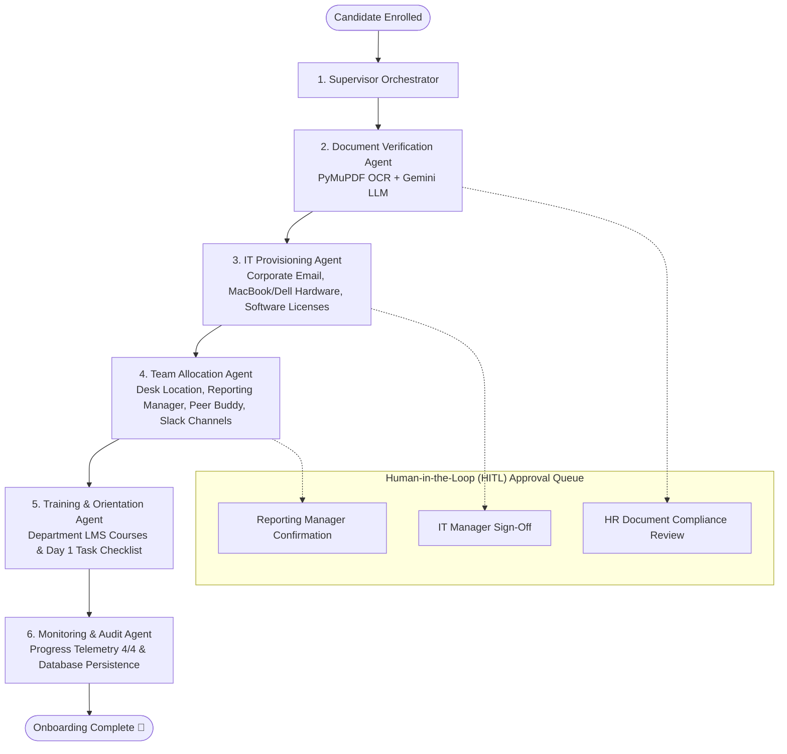

# EnterpriseFlow AI — Unified Multi-Agent Employee Onboarding Platform

A complete, production-ready, full-stack multi-agent employee onboarding system powered by **FastAPI**, **LangGraph**, **PyMuPDF**, and **React 19 (Vite)**.

All features from the constituent modules have been merged into a single clean codebase featuring multimodal KYC document verification, automated IT provisioning, departmental team allocation, training LMS paths, and human-in-the-loop (HITL) approval gates.

---

## 🌟 Repository Structure

```
enterpriseflow-ai/
├── backend/                       # FastAPI + LangGraph Multi-Agent Orchestrator
│   ├── agents/                    # 5 specialized AI agents + Supervisor
│   │   ├── state.py               # Shared AgentState across all agents
│   │   ├── orchestrator.py        # LangGraph StateGraph pipeline
│   │   ├── document_verification.py # PyMuPDF OCR + Gemini/Rule-based Doc Agent
│   │   ├── it_provisioning.py     # Email, Hardware tickets & Software bundles
│   │   ├── team_allocation.py     # Desk, Reporting Manager, Buddy & Slack channels
│   │   ├── training.py            # Department LMS courses & Day 1 checklist
│   │   └── monitoring.py          # Progress tracking (4/4) & alerting
│   ├── api/
│   │   └── routes.py              # Full REST API (onboarding, approvals, employees, docs, logs)
│   ├── db/
│   │   ├── models.py              # SQLAlchemy models (Employee, Task, AuditLog, Approval, etc.)
│   │   └── session.py             # Auto-seeds 5 synthetic demo employees & test data
│   ├── services/
│   │   ├── ocr_service.py         # PyMuPDF text & document extraction
│   │   ├── llm_service.py         # Gemini LLM with timeout & rule fallback
│   │   ├── mock_external_apis.py  # Email, Hardware, Software, HRMS & Calendar mock engines
│   │   └── audit.py               # Database audit logger
│   └── uploads/test_docs/         # Sample PDF test documents
├── frontend/                      # React 19 + Lucide UI SPA (Vite)
│   ├── src/
│   │   ├── App.jsx                # Full interactive UI (Dashboard, Live Pipeline, Approvals, etc.)
│   │   └── style.css              # Modern dark-mode responsive theme
│   └── dist/                      # Pre-built production SPA bundle
├── run_app.py                     # Single runner serving API & UI on port 8000
├── start_backend.bat              # Windows batch launcher for backend
├── start_frontend.bat             # Windows batch launcher for Vite dev mode
├── start_unified_app.bat          # ⚡ One-click launcher for Windows
├── requirements.txt               # Python package dependencies
├── .env.example                   # Environment variables template
└── README.md                      # Comprehensive documentation
```

---

## 🤖 The Multi-Agent Workflow



---

## 🚀 Quick Start

### 1. One-Click Launch (Windows)
Double-click:
```bat
start_unified_app.bat
```

### 2. Manual Command Line
```powershell
# Activate virtual environment
.\.venv\Scripts\activate

# Launch the unified server
python run_app.py
```

Open your browser:
* **Web Application**: [http://localhost:8000](http://localhost:8000)
* **Interactive Swagger API Docs**: [http://localhost:8000/docs](http://localhost:8000/docs)

---

## 🛠️ Tech Stack

- **Backend**: Python 3.12+, FastAPI, Uvicorn, LangGraph, LangChain Core, PyMuPDF, Pydantic, SQLAlchemy.
- **Frontend**: React 19, Vite, Lucide React, Modern Dark Mode CSS.
- **AI & Vision**: Gemini API (`google-genai`), PyMuPDF OCR text engine, resilient rule-based extraction fallback.
- **Database**: SQLite (default zero-dependency) with seamless PostgreSQL support via SQLAlchemy ORM.

---

## 🛡️ Human-in-the-Loop (HITL) Governance & Active Pausing

Unlike traditional linear automation scripts, EnterpriseFlow AI implements **real active pause gates** within the LangGraph multi-agent execution graph:

1. **Active IT Access Gate**:
   - The IT Provisioning Agent drafts hardware specs, corporate credentials, and 8+ software license assignments.
   - The graph conditional edge detects that human approval is pending (`it_approved: False`).
   - The pipeline **halts execution** at Stage 3. The UI freezes with a pulsing amber warning banner, displays a compliance verification checklist, and exposes `Authorize & Proceed` and `Reject Request` controls.
   - Downstream agents (Team Allocation and Training) are prevented from executing until authorization is signed off.

2. **Manager Confirmation Gate**:
   - Upon IT sign-off, the pipeline automatically resumes and triggers the Team Allocation Agent.
   - The agent assigns a Department Team, Peer Buddy, Reporting Manager, and Physical Desk.
   - Before confirming organizational records, the graph again pauses for manager acknowledgment.
   - Once authorized, the graph resumes to completion (Training & LMS assignment -> 100% complete).

---

## 📋 Supported Workflows

| Workflow | Participating Agents | Output & Deliverables |
| :--- | :--- | :--- |
| **1. Multimodal Document Verification** | Document Verification Agent | OCR text extraction, ID/Passport validation, compliance status, audit log. |
| **2. IT & Hardware Provisioning** | IT Provisioning Agent | Corporate email creation, hardware procurement ticket (MacBook/Dell), software licenses, active HITL checkpoint. |
| **3. Team & Workspace Allocation** | Team Allocation Agent | Department assignment, Reporting Manager pairing, Peer Buddy assignment, Desk location, Slack channels. |
| **4. Role-Based LMS Training** | Training & Orientation Agent | Day 1 checklist, compliance training courses, interactive status toggling. |
| **5. Continuous Monitoring & Audit** | Monitoring & Audit Agent | Progress telemetry (0–100%), full cryptographic audit trail, exception alerts. |

---

## 💡 Assumptions & Design Decisions

1. **Zero-Dependency Startup**: Built with SQLite and mock enterprise API adapters (ServiceNow, Okta, Google Workspace, Slack) so hackathon evaluators can test end-to-end functionality immediately without third-party credentials.
2. **Dual-Model Resilience**: Document verification utilizes Gemini API when `GEMINI_API_KEY` is present, with an automated fallback to high-fidelity regex/rule-based OCR parsing if offline.
3. **Decoupled Architecture**: REST API endpoints strictly adhere to OpenAPI 3.0 specs, allowing the backend agent graph to be driven either via the React UI or external CI/CD & HRMS webhooks.

---

## ⚠️ Known Limitations & Future Roadmap

1. **Identity Provider Integration**: Current corporate email generation uses simulated directory provisioning; enterprise production would integrate direct SCIM 2.0 connectors for Okta / Azure AD.
2. **Document Forgery Detection**: Document verification inspects text and layout consistency; integration with forensic image tamper detection (EXIF metadata analysis) is planned for future iterations.
3. **Bi-directional WebSockets**: Current telemetry updates via reactive REST polling; migrating to persistent WebSocket channels will enable sub-millisecond multi-client streaming.

